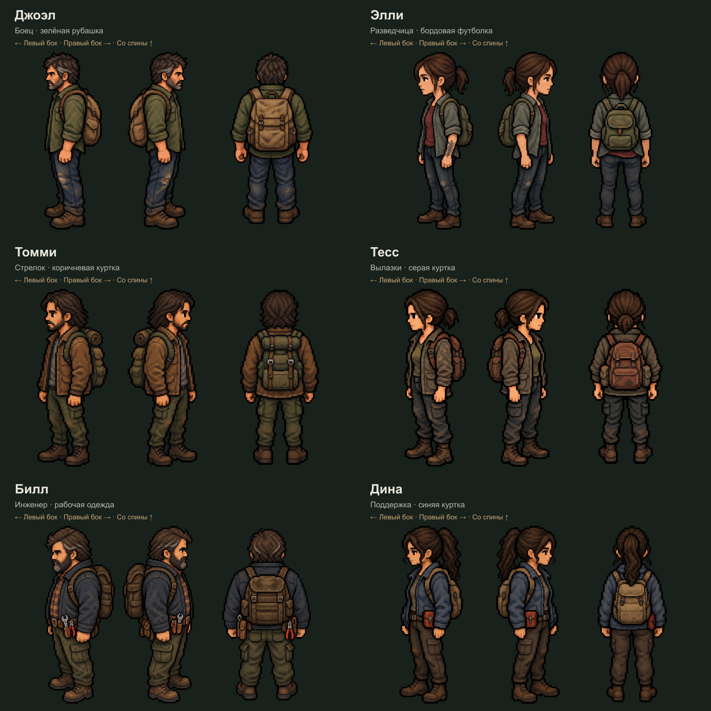
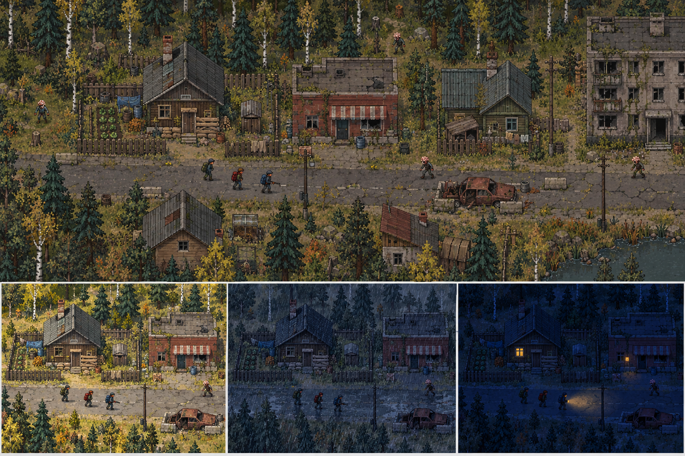
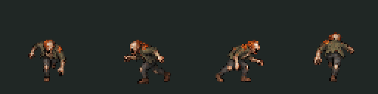
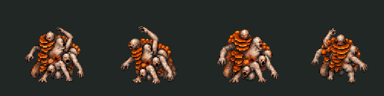
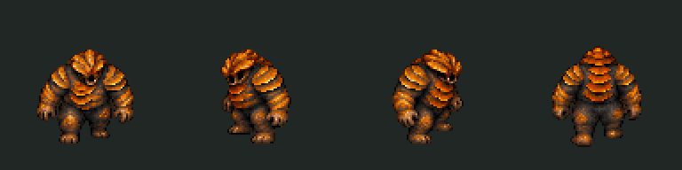
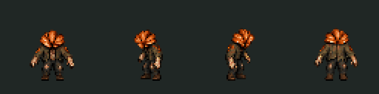
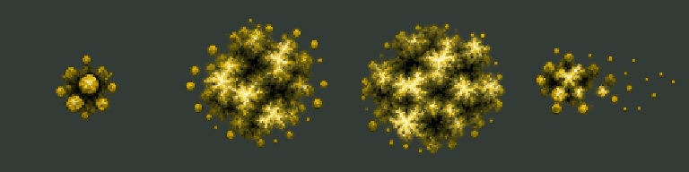
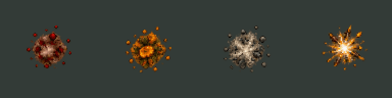

# Pixel Apocalypse — рабочее название

Материалы для кооперативной пиксельной игры о выживании после грибного апокалипсиса. Вдохновение: исследование и выживание Mini DAYZ, атмосфера и заражённые The Last of Us. Целевая платформа — отдельное приложение Windows, кооператив на 2–6 игроков.

**Сейчас в репозитории графика, анимации, инструменты экспорта и дизайн-документация. Полноценная игра, ИИ, бой, генерация мира и сетевой сервер ещё не реализованы.**

## Персонажи и правила

- [Шесть выживших: внешность, характер, роли, плюсы, минусы, атаки](docs/survivors.md).
- [Шесть заражённых: поведение, сильные стороны, слабости, атаки](docs/infected.md).
- [Общие правила боя и взаимодействия](docs/combat-design.md).
- [Согласованное направление игры](docs/game-direction.md).
- [Каталог графики, анимаций и скриншотов](docs/asset-catalog.md).
- [Полный список файлов с размером и SHA-256](docs/asset-inventory.json).

Числовые особенности выживших и описанные механики — предложения для первого баланса. Они ещё не закодированы. Роли не запрещают другим персонажам пользоваться оружием, строить или лечить.

## Визуал

### Заражённые

Актуальный набор: [infected-animation-pack-v5](assets/infected-animation-pack-v5/README.md). Отдельные дополнения: [реакции на удары](assets/infected-reactions-v1/README.md), [смерть и тела](assets/infected-deaths-v1/README.md), [специальные атаки и фазы босса](assets/infected-specials-v1/README.md).

- 6 типов: runner, stalker, clicker, bloater, shambler, rat-king.
- 4 направления: south, west, east, north.
- 8 общих действий: idle, walk, run, attack, hurt, stunned, knockback, death.
- Топляку добавлен бросок нароста; боссу — подготовка/бег/завершение тарана, двойное комбо, удар по земле и два перехода фаз.
- По 6 кадров: **224 анимации персонажей, 1344 прозрачных PNG-кадра и 24 неподвижных тела**. Спецприёмы — 32 новые анимации и 192 кадра.
- Отдельно 4 эффекта: летящий нарост, всплеск и облако спор, пыль от удара. Это ещё 24 кадра; с эффектами **228 анимаций и 1368 кадров**.
- 24 спрайт-листа, JSON-атласы и настройки анимаций.
- 224 GIF отдельных движений, 56 сравнительных GIF, 4 GIF эффектов и 2 составных ролика тарана/переходов фаз.

Распакуйте/клонируйте репозиторий и откройте `assets/infected-animation-pack-v5/preview.html` двойным щелчком для просмотра движений. По умолчанию выбран бросок топляка; можно выбрать босса, все движения, переходы фаз или эффекты. В просмотре атаки повторяются, а игровые настройки однократные. Смерть удерживает последний кадр. На GitHub HTML отображается как исходный код; для проигрывания откройте его локально. Это просмотрщик графики, не браузерная версия игры.

Три предлагаемые фазы босса: обычный бой → натиск с тараном и комбо → ярость с ударом по земле. Пороги 65%/30% — предварительный баланс. Фазы различаются переходами и доступными приёмами; серверная логика боя ещё не реализована. [Настройки фаз](assets/infected-specials-v1/boss-phases.json).

Каждый `corpse.png` совпадает с финальным кадром смерти; тело неподвижно и не считается дополнительной анимацией. Пример Phaser содержит однократную смерть и восстановление тела из сохранённого состояния. Сохранение тел сервером и их обыск пока не реализованы.

hurt и knockback однократные, stunned зациклен до снятия состояния игровым кодом. Отбрасывание на карте рассчитывается физикой отдельно: у новых анимаций `rootMotion: false`. Система урона и оглушения пока не реализована.

Предыдущие версии [v1](assets/infected-animation-pack-v1/README.md) (24 анимации, направление вниз), [v2](assets/infected-animation-pack-v2/README.md) (96 анимаций), [v3](assets/infected-animation-pack-v3/README.md) (168 с реакциями) и [v4](assets/infected-animation-pack-v4/README.md) (192 со смертью) сохранены целиком. Это предыдущие итерации тех же типов, а не дополнительные типы врагов.

### Споры, кровь и попадания

[combat-vfx-v1](assets/combat-vfx-v1/README.md) дополняет v5: **16 новых анимаций, 96 прозрачных кадров и один статичный след крови**. Четыре эффекта спор; лёгкие/сильные брызги, лужа и капля; брызги в четырёх направлениях; попадания по телу, грибной броне, камню и металлу. Набор общий для всех заражённых. Вместе с v5 получается 244 уникальные анимации и 1464 кадра; прежние версии повторно не суммируются.

В комплекте PNG, атласы, JSON, GIF, исходники и пример Phaser. [Архив](output/combat-vfx-v1.zip), [локальный просмотрщик](assets/combat-vfx-v1/preview.html), [скриншоты](output/qa-combat-vfx). Короткие эффекты однократные, облако/шлейф циклические, лужа удерживает последний кадр. Урон и серверные зоны спор пока не реализованы.

### Выжившие

[Статичный набор](assets/survivor-visuals-v1/README.md): Джоэл, Элли, Томми, Тесс, Билл, Дина. Для каждого левый бок, правый бок и вид со спины — 18 видов. Передний ракурс исключён по запросу пользователя. Анимаций выживших пока нет.

Первый общий лист выживших в `assets/concepts/survivors-v1.png` — ранний референс стиля с другими вариантами одежды; выбранные шесть персонажей находятся в `assets/survivor-visuals-v1`.

## Архивы и скриншоты

Готовые ZIP сохранены в [output](output). Там же находятся скриншоты просмотра анимаций, контактные листы и папка [qa-v2](output/qa-v2) со скриншотами всех шести заражённых. Все исходники и прежние версии включены для истории проекта.

## Инструменты

Node.js 24, пакеты sharp и jszip для экспорта; Playwright и Microsoft Edge для проверки просмотрщика. `npm install` устанавливает зависимости инструментов, `npm run check:assets` проверяет файлы текущих наборов. `npm run check:viewer` дополнительно проверяет локальный просмотрщик в Edge.

`npm run check:deaths` проверяет v4: кадры и атласы, сохранность v3, совпадение тел с последним кадром, завершение смерти в примере Phaser и работу просмотрщика.

`npm run check:specials` проверяет v5: сохранность v4, новые приёмы и эффекты, прозрачные края, события атак, защиту от повторной отправки событий, блокировку после смерти, очистку подписок/VFX, ссылки фаз и просмотрщики. Это проверки ресурсов и примеров интеграции, не полноценного боя в игре.

Скрипты в `tools` нарезают и упаковывают уже созданные изображения; они не генерируют новую графику. Позы созданы встроенным image_gen. Полные запросы сохранены рядом с наборами, а первоначальные — в [docs/art-prompts-v1.md](docs/art-prompts-v1.md).

Предполагаемый стек самой игры: Phaser + TypeScript + Electron, Node.js + Colyseus для онлайна. Зависимости игры пока не подключены. Пиксельные концепты потребуют проверки в масштабе игрового мира; сгенерированные детали могут немного различаться между ракурсами и кадрами.
