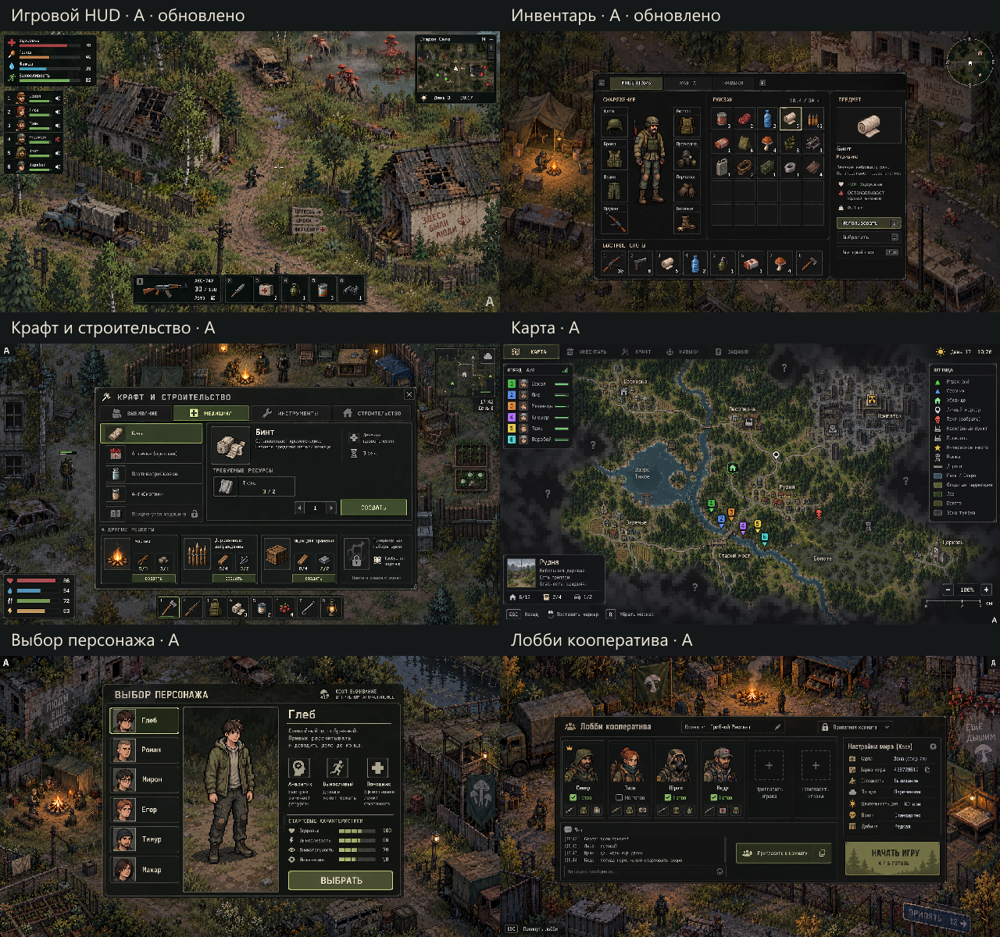
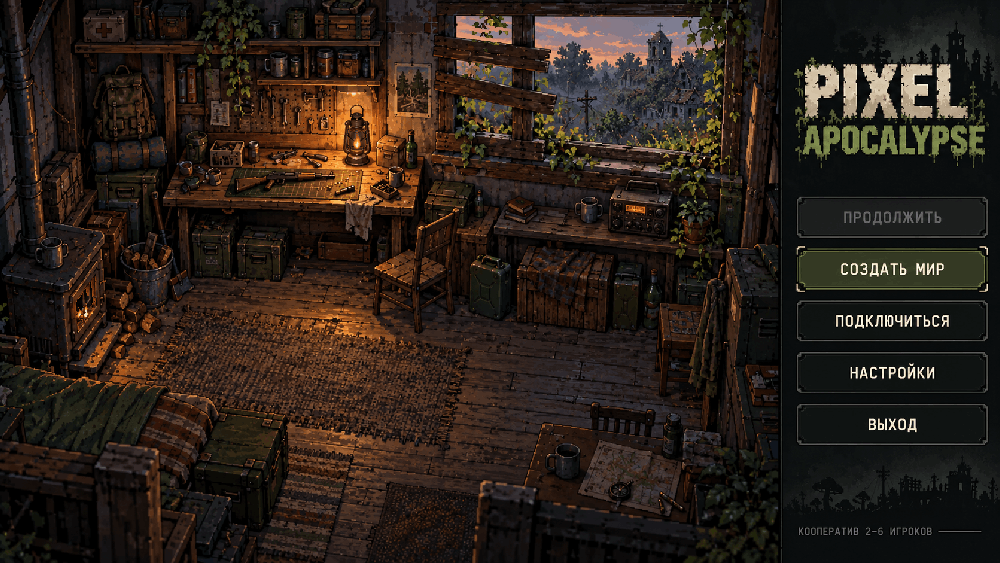
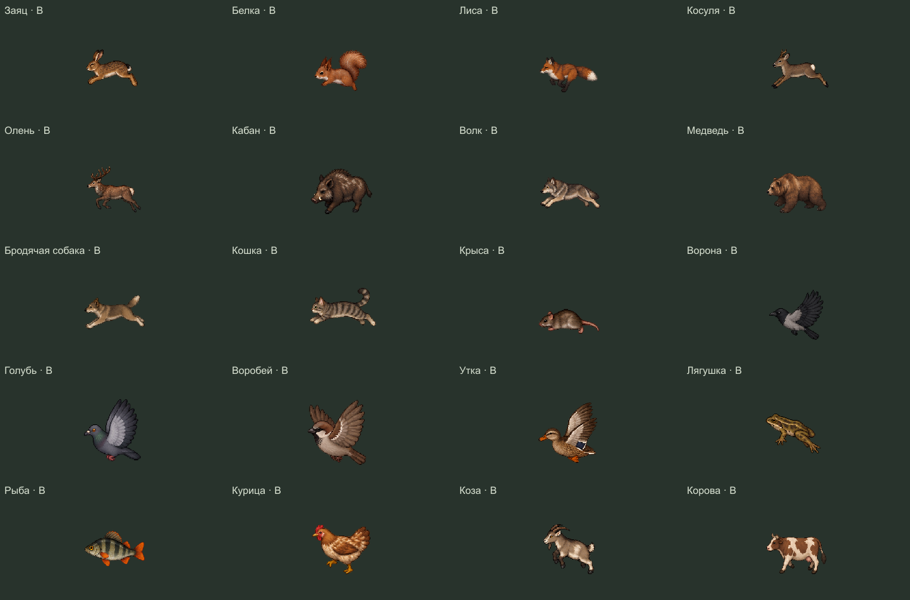
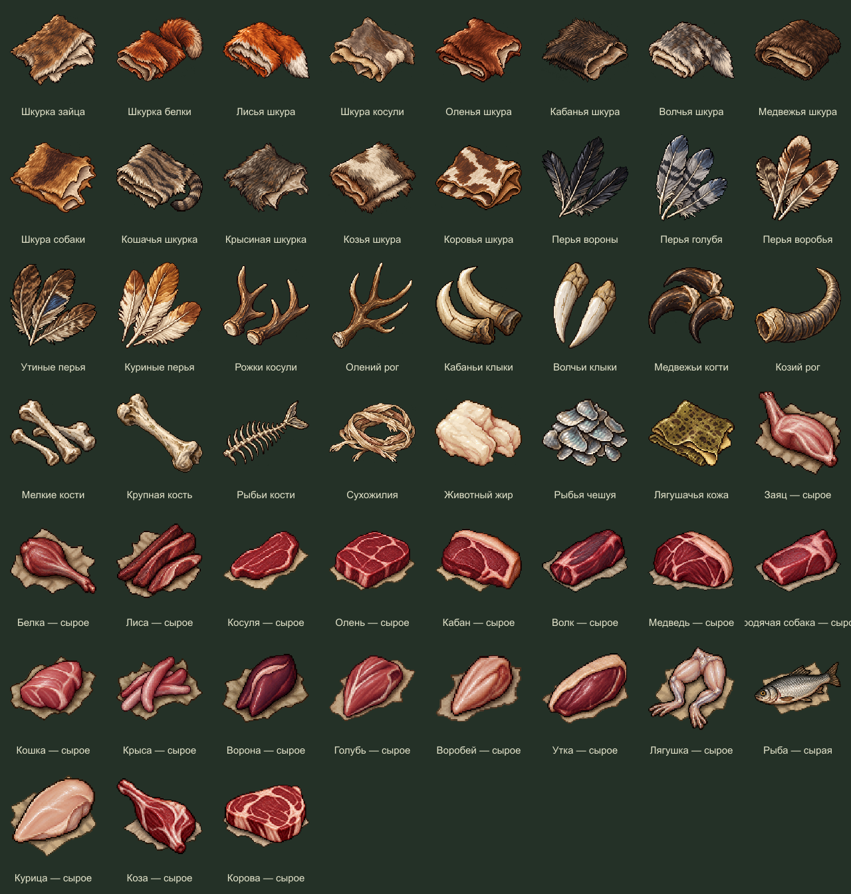
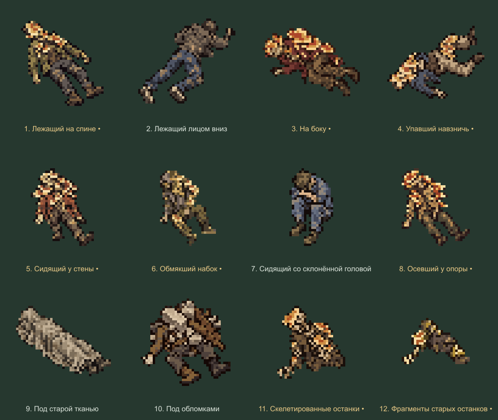

# Pixel Apocalypse

Кооперативное пиксельное выживание после грибного апокалипсиса. Исследование мира, поиск припасов, скрытность, оружие и укрепление базы. Планируется отдельное приложение Windows для **2–6 игроков**.

**Актуальные материалы — 18 октября 2026 года:** шесть новых выживших, 18 заражённых, 20 видов животных, 24 образца оружия, окружение и эффекты.

Проект находится на этапе графики и проектирования. Полноценная игра, ИИ, бой и сетевой сервер ещё не реализованы.

Проверены пересечения 20 текущих наборов. [Единый реестр](docs/asset-registry.json) · [Что объединено](docs/asset-conflicts.md) · [Отчёт проверки](docs/asset-consistency-report.json).

## Интерфейс — утверждённый вариант A

Шесть визуальных макетов: HUD, инвентарь, крафт и строительство, карта, выбор персонажа, лобби кооператива. У HUD убраны задачи справа; в инвентаре восемь слотов снаряжения, включая штаны и противогаз.

[Все экраны](assets/interface-selected-v1/README.md) · [ZIP](assets/interface-selected-v1.zip) · [Решения по интерфейсу](docs/interface-direction.md) · [Исходные варианты A/B/C](assets/interface-concepts-v1)

Это утверждённое визуальное оформление. Игровой интерфейс ещё не реализован; содержимое макетов иллюстративное.

## Главное меню — анимированный прототип C

Убежище с кнопками справа. Листва слегка покачивается, пламя фонаря и печки меняется, свет мягко мерцает. Камера и панель меню неподвижны. Цикл 4,8 секунды: 48 кадров, 10 кадров/с.

[Файлы прототипа](assets/main-menu-animation-v1/README.md) · [WebP полного разрешения](assets/main-menu-animation-v1/main-menu.webp) · [PNG-кадры](assets/main-menu-animation-v1/frames) · [Полный ZIP в релизе](https://github.com/L1m1rd/pixel-apocalypse-game/releases/tag/main-menu-animation-v1)

Визуальный прототип, обработчики кнопок ещё не реализованы. Название Pixel Apocalypse рабочее.

## Выжившие — новый состав

**Глеб · Роман · Мирон · Егор · Тимур · Макар**

[Отдельные образы](assets/survivor-friends-pixel-v1/art) · [Прозрачные спрайты](assets/survivor-friends-pixel-v1/sprites) · [Описание состава](docs/survivors.md)

Готовы статичные модели, реалистичные референсы и **864 анимации, 5184 прозрачных кадра и 24 лежащих тела**: 36 действий для каждого героя, спереди, сзади и с обоих боков. Движение, стелс, взаимодействия, выживание, работа, бой, оружейные хваты, реакции и смерть.

[Полный набор](assets/survivor-friends-animations-v1/README.md) · [Все анимации — ZIP](assets/survivor-friends-animations-v1/downloads/all.zip) · [Просмотрщик](assets/survivor-friends-animations-v1/preview.html) · [Проверки](assets/survivor-friends-animations-v1/verification.json)

Оружие, инструменты, расходники и рюкзаки добавляются отдельными слоями. Здесь подготовлены движения тела и хваты; игровой код не добавлен.

## Заражённые — 18 новых образов

Шесть видов, по три класса: **A — слабый, B — средний, C — сильный** внутри своего вида.

| Вид | A | B | C |
|---|---|---|---|
| Быстрые | Жильник | Косой | Пружинник |
| Засадные | Теневик | Лазутчик | Складень |
| Сенсорные | Резонатор | Усик | Гул |
| Бронированные | Сланец | Кокон | Роговик |
| Распространители | Сотовик | Дымарь | Стручник |
| Боссы | Перекос | Колонна | Тягун |

Готовы **672 анимации, 4032 кадра и 72 неподвижных тела**, четыре направления.

[Полный набор анимаций](assets/infected-redesign-animations-v1/README.md) · [Пиксельные модели](assets/infected-redesign-pixel-v1/README.md) · [Реалистичные референсы](assets/infected-redesign-realistic-v1/README.md) · [Описание видов](docs/infected.md)

## Животные — выбран вариант B

У всех 20 видов выбран второй облик B. Готовы **284 анимации и 1704 прозрачных кадра**: собственные движения каждого вида, четыре направления, полёт и передвижение птиц по земле, прыжок лягушки, плавание утки, лягушки и рыбы.

Бродячая собака, медведь, волк, кабан, олень и косуля получили отдельные атаки. [Полный набор](assets/wildlife-animations-v1/README.md) · [Просмотрщик](assets/wildlife-animations-v1/preview.html) · [Проверка](assets/wildlife-animations-v1/verification.json) · [ZIP в релизе](https://github.com/L1m1rd/pixel-apocalypse-game/releases/tag/wildlife-animations-v1) · [Статичные образы](assets/wildlife-visuals-v1/README.md).

Исходники, точные запросы, PNG, спрайт-листы, атласы, GIF и настройки проигрывания сохранены. ИИ, перемещение по миру, коллизии и урон ещё не реализованы.

## Дроп животных — общие ресурсы без дублей

31 материал животных: шкуры, перья, рога, клыки, когти, кости, сухожилия, жир, чешуя и лягушачья кожа — 93 собственных PNG. Мясо и рыба для всех 20 видов подключены из единого каталога еды: ещё 20 общих записей без повторного экспорта. Всего в таблице дропа 51 ресурс.

[Полный набор](assets/wildlife-loot-v1/README.md) · [Что выпадает с каждого вида](assets/wildlife-loot-v1/loot-table.json) · [Просмотрщик](assets/wildlife-loot-v1/preview.html) · [Архив в релизе](https://github.com/L1m1rd/pixel-apocalypse-game/releases/tag/asset-consistency-v1). Количество, вероятности и игровое выпадение ещё не реализованы.

## Оружие — 24 образца

| Категория | Образцы |
|---|---|
| Пистолеты | ПМ, Glock 17, Colt M1911 |
| Револьверы | Наган M1895, Colt Python, Smith & Wesson Model 686 |
| Двустволки | ИЖ-43, ТОЗ-34, ИЖ-27 |
| Помповые дробовики | Remington 870, Mossberg 500, Winchester Model 1897 |
| Пистолеты-пулемёты | HK MP5, ПП-91 «Кедр», Uzi |
| Самозарядные карабины | СКС, Ruger Mini-14, M1 Carbine |
| Автоматы | АКМ, АК-74, M4A1 |
| Винтовки с ручной перезарядкой | Мосина 1891/30, Remington 700, Winchester Model 70 |

Для всех 24 образцов добавлены **48 анимаций и 576 прозрачных кадров**: выстрел и перезарядка. [Полный набор и GIF](assets/weapon-animations-v1/README.md) · [Локальный просмотрщик](assets/weapon-animations-v1/preview.html). Один боковой ракурс вправо, отдельный слой без персонажа; характеристики и игровая стрельба пока не реализованы.

## Предметы и объекты — новая версия

**269 позиций каталога.** У 18 объектов мира используются общие изображения окружения; доски заведены одним ресурсом. Четыре культуры и посадочный материал, три плодовых дерева, фляга, обновлённая медицина, три типа боеприпасов, пять рюкзаков, защита трёх уровней, 72 варианта одежды, травы, методички, провода и целые окна. Мясо и рыба — 20 пар «сырое / жареное» по составу животных проекта.

[Полный каталог](assets/item-visuals-v2/README.md) · [Просмотрщик с поиском](assets/item-visuals-v2/preview.html) · [72 варианта одежды](assets/item-visuals-v2/clothing-overview.png) · [Мясо и рыба](assets/item-visuals-v2/food-overview.png) · [Игровые договорённости](docs/items-design.md).

[Полный ZIP предметов в релизе](https://github.com/L1m1rd/pixel-apocalypse-game/releases/tag/asset-consistency-v1).

Это статичная графика и проект правил. Крафт, рост растений, сбор урожая, лечение, переноска, установка проводов и надевание экипировки ещё не реализованы. Прежний набор предметов заменён в текущей публикации; история Git сохранена.

## Окружение

[Готовые элементы](assets/environment-variants-v1/elements) · [Манифест готовности](assets/environment-variants-v1/manifest.json) · [Локальный просмотрщик](assets/environment-variants-v1/preview.html)

Готовы **119 элементов по три близких варианта — 357 вариантов**: 258 статичных изображений, 90 анимаций на 540 кадров и 9 референсов освещения. Все варианты одного элемента предназначены для совместного использования на карте. Сохранены исходники, запросы генерации, отдельные PNG, спрайт-листы, JSON-атласы и GIF.

[Описание полного набора](assets/environment-variants-v1/README.md) · [Общий ZIP в релизе](https://github.com/L1m1rd/pixel-apocalypse-game/releases/tag/environment-variants-v1)

Проверка файлов и просмотрщика пройдена. Стыковка покрытий, соединения дорог и отмеченные края кадров требуют проверки в игровом движке; сцены освещения служат референсами.

## Декоративные тела и останки

12 статичных объектов: восемь заражённых с крупными наростами и четыре обычных варианта. Крупный пиксель 48×48, до 16 цветов, также подготовлены версии 96×96.

[Все PNG и исходники](assets/decorative-corpses-v2/README.md) · [Скачать ZIP](assets/decorative-corpses-v2.zip) · [Будущий сбор органики для крафта](docs/corpse-organic-materials.md)

Сейчас это декорации. На будущее согласован сбор с этих тел органических материалов для крафта; конкретные рецепты и правила сбора ещё не назначены.

## Эффекты боя

[Споры, кровь и попадания](assets/combat-vfx-v1/README.md): 16 анимаций, 96 кадров, один след крови. [Специальные эффекты](assets/special-vfx-v1/README.md): летящий нарост, всплеск и облако спор, пыль удара. Изображения эффектов сохранены без перерисовки.

## Просмотр и инструменты

PNG/GIF доступны прямо на GitHub. HTML-просмотрщики открываются локально после скачивания или клонирования проекта:

- Заражённые: `assets/infected-redesign-animations-v1/preview.html`.
- Выжившие: `assets/survivor-friends-animations-v1/preview.html`.
- Эффекты: `assets/combat-vfx-v1/preview.html`.
- Окружение: `assets/environment-variants-v1/preview.html`.

Для инструментов нужен Node.js 24: `npm install`. Проверка файлов и ссылок: `npm run check:assets`. Подробные проверки: `npm run check:redesigned` и `npm run check:combat-vfx`.

[Каталог материалов](docs/asset-catalog.md) · [Направление игры](docs/game-direction.md) · [Правила боя](docs/combat-design.md) · [Перечень файлов](docs/asset-inventory.json)

Устаревшие наборы удалены из текущего дерева GitHub. Ранние версии доступны в истории коммитов.
