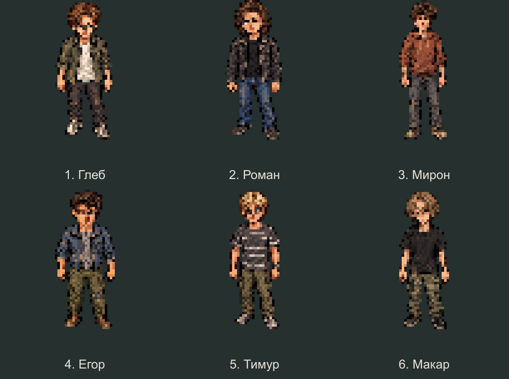
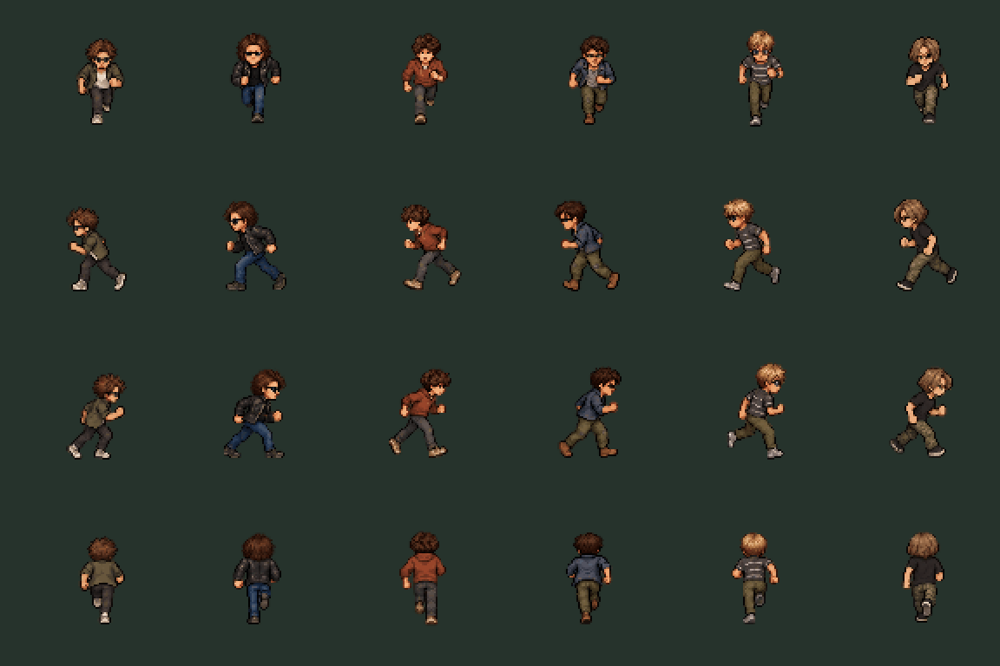
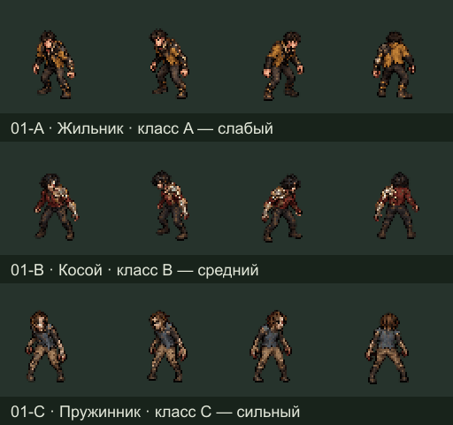
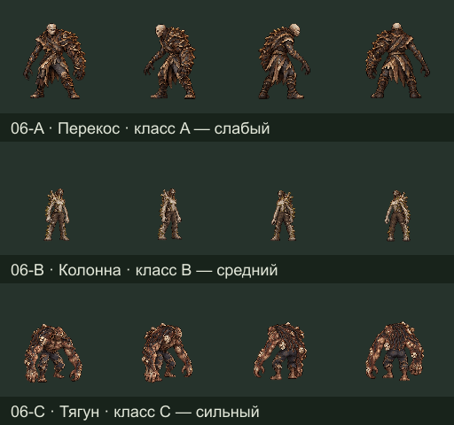
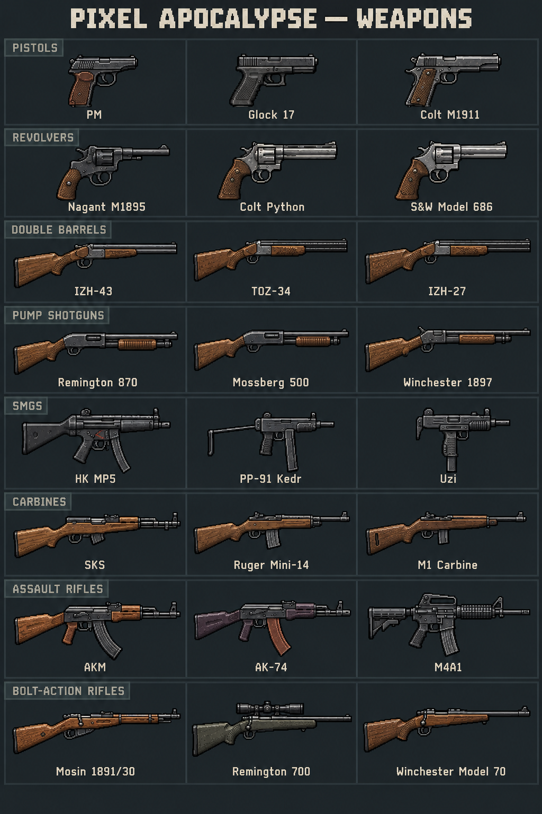
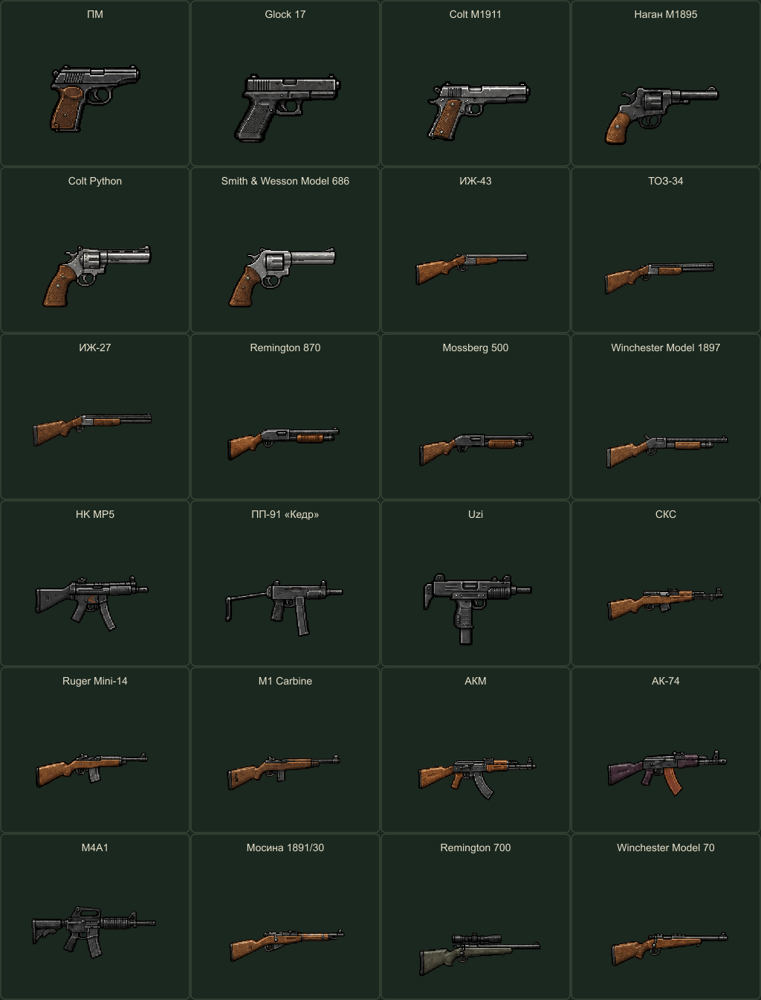
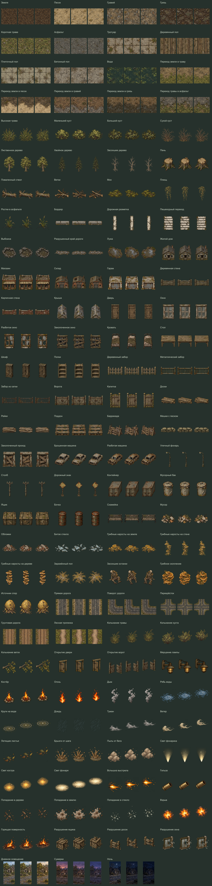

# Pixel Apocalypse

Кооперативное пиксельное выживание после грибного апокалипсиса. Исследование мира, поиск припасов, скрытность, оружие и укрепление базы. Планируется отдельное приложение Windows для **2–6 игроков**.

**Актуальные материалы — 18 октября 2026 года:** шесть новых выживших, 18 заражённых, 24 образца оружия, окружение и эффекты.

Проект находится на этапе графики и проектирования. Полноценная игра, ИИ, бой и сетевой сервер ещё не реализованы.

## Выжившие — новый состав

**Глеб · Роман · Мирон · Егор · Тимур · Макар**

[Отдельные образы](assets/survivor-friends-pixel-v1/art) · [Прозрачные спрайты](assets/survivor-friends-pixel-v1/sprites) · [Описание состава](docs/survivors.md)

Готовы статичные модели, реалистичные референсы и **864 анимации, 5184 прозрачных кадра и 24 лежащих тела**: 36 действий для каждого героя, спереди, сзади и с обоих боков. Движение, стелс, взаимодействия, выживание, работа, бой, оружейные хваты, реакции и смерть.

[Полный набор](assets/survivor-friends-animations-v1/README.md) · [Все анимации — ZIP](assets/survivor-friends-animations-v1/downloads/all.zip) · [Просмотрщик](assets/survivor-friends-animations-v1/preview.html) · [Проверки](assets/survivor-friends-animations-v1/verification.json)

Оружие, инструменты, расходники и рюкзаки добавляются отдельными слоями. Здесь подготовлены движения тела и хваты; игровой код не добавлен.

## Заражённые — 18 новых образов

Шесть видов, по три класса: **A — слабый, B — средний, C — сильный** внутри своего вида.

| Вид | A | B | C |
|---|---|---|---|
| Быстрые | Жильник | Косой | Пружинник |
| Засадные | Теневик | Лазутчик | Складень |
| Сенсорные | Резонатор | Усик | Гул |
| Бронированные | Сланец | Кокон | Роговик |
| Распространители | Сотовик | Дымарь | Стручник |
| Боссы | Перекос | Колонна | Тягун |

Готовы **672 анимации, 4032 кадра и 72 неподвижных тела**, четыре направления.

[Полный набор анимаций](assets/infected-redesign-animations-v1/README.md) · [Пиксельные модели](assets/infected-redesign-pixel-v1/README.md) · [Реалистичные референсы](assets/infected-redesign-realistic-v1/README.md) · [Описание видов](docs/infected.md)

## Оружие — 24 образца

| Категория | Образцы |
|---|---|
| Пистолеты | ПМ, Glock 17, Colt M1911 |
| Револьверы | Наган M1895, Colt Python, Smith & Wesson Model 686 |
| Двустволки | ИЖ-43, ТОЗ-34, ИЖ-27 |
| Помповые дробовики | Remington 870, Mossberg 500, Winchester Model 1897 |
| Пистолеты-пулемёты | HK MP5, ПП-91 «Кедр», Uzi |
| Самозарядные карабины | СКС, Ruger Mini-14, M1 Carbine |
| Автоматы | АКМ, АК-74, M4A1 |
| Винтовки с ручной перезарядкой | Мосина 1891/30, Remington 700, Winchester Model 70 |

Для всех 24 образцов добавлены **48 анимаций и 576 прозрачных кадров**: выстрел и перезарядка. [Полный набор и GIF](assets/weapon-animations-v1/README.md) · [Локальный просмотрщик](assets/weapon-animations-v1/preview.html). Один боковой ракурс вправо, отдельный слой без персонажа; характеристики и игровая стрельба пока не реализованы.

## Окружение

[Готовые элементы](assets/environment-variants-v1/elements) · [Манифест готовности](assets/environment-variants-v1/manifest.json) · [Локальный просмотрщик](assets/environment-variants-v1/preview.html)

Готовы **119 элементов по три близких варианта — 357 вариантов**: 258 статичных изображений, 90 анимаций на 540 кадров и 9 референсов освещения. Все варианты одного элемента предназначены для совместного использования на карте. Сохранены исходники, запросы генерации, отдельные PNG, спрайт-листы, JSON-атласы и GIF.

[Описание полного набора](assets/environment-variants-v1/README.md) · [Общий ZIP в релизе](https://github.com/L1m1rd/pixel-apocalypse-game/releases/tag/environment-variants-v1)

Проверка файлов и просмотрщика пройдена. Стыковка покрытий, соединения дорог и отмеченные края кадров требуют проверки в игровом движке; сцены освещения служат референсами.

## Эффекты боя

[Споры, кровь и попадания](assets/combat-vfx-v1/README.md): 16 анимаций, 96 кадров, один след крови. [Специальные эффекты](assets/special-vfx-v1/README.md): летящий нарост, всплеск и облако спор, пыль удара. Изображения эффектов сохранены без перерисовки.

## Просмотр и инструменты

PNG/GIF доступны прямо на GitHub. HTML-просмотрщики открываются локально после скачивания или клонирования проекта:

- Заражённые: `assets/infected-redesign-animations-v1/preview.html`.
- Выжившие: `assets/survivor-friends-animations-v1/preview.html`.
- Эффекты: `assets/combat-vfx-v1/preview.html`.
- Окружение: `assets/environment-variants-v1/preview.html`.

Для инструментов нужен Node.js 24: `npm install`. Проверка файлов и ссылок: `npm run check:assets`. Подробные проверки: `npm run check:redesigned` и `npm run check:combat-vfx`.

[Каталог материалов](docs/asset-catalog.md) · [Направление игры](docs/game-direction.md) · [Правила боя](docs/combat-design.md) · [Перечень файлов](docs/asset-inventory.json)

Устаревшие наборы удалены из текущего дерева GitHub. Ранние версии доступны в истории коммитов.
