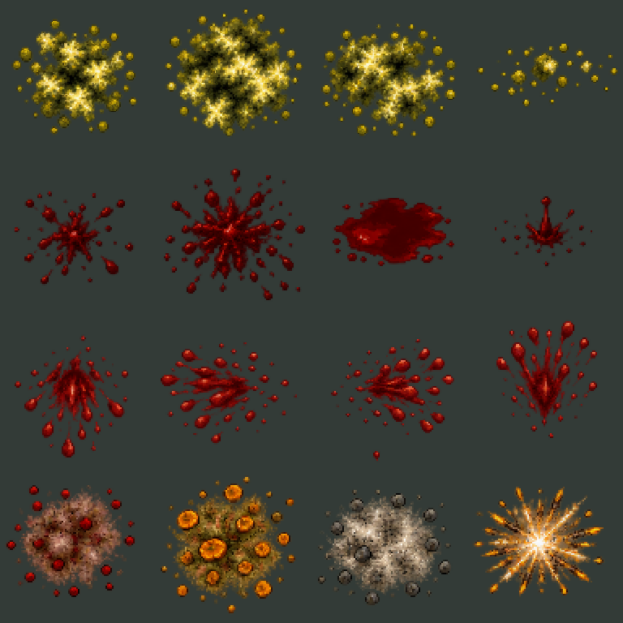

# Споры, кровь и попадания — v1

**16 новых анимаций, 96 прозрачных PNG-кадров и один неподвижный след крови.** Отдельное дополнение к [новым заражённым](../infected-redesign-animations-v1/README.md). Эффекты подходят всем шести типам: отдельные копии для каждого монстра не нужны. Здесь готова графика и пример подключения; полноценная система боя ещё не реализована.



## Состав

У каждой анимации шесть кадров. Размер — размер прозрачного холста, а не игровая площадь урона. Точка привязки всех эффектов: центр `(0.5, 0.5)`.

| Группа | ID | Холст | Кадр, мс | Поведение примера |
|---|---|---|---|---|
| Споры | spore_emission | 128×128 | 100 | Выброс, исчезновение |
| Споры | spore_cloud_dense | 128×128 | 160 | Плотное облако, цикл |
| Споры | spore_dissipate | 128×128 | 140 | Рассеивание, исчезновение |
| Споры | spore_trail | 128×128 | 140 | Шлейф, цикл |
| Кровь | blood_hit_small | 96×96 | 80 | Лёгкие брызги, исчезновение |
| Кровь | blood_hit_heavy | 96×96 | 100 | Сильные брызги, исчезновение |
| Кровь | blood_pool_form | 96×96 | 160 | Образование лужи → неподвижный след |
| Кровь | blood_drip | 96×96 | 120 | Капля и маленький всплеск, исчезновение |
| Направленные брызги | blood_hit_south | 96×96 | 90 | Брызги вниз, исчезновение |
| Направленные брызги | blood_hit_west | 96×96 | 90 | Брызги влево, исчезновение |
| Направленные брызги | blood_hit_east | 96×96 | 90 | Брызги вправо, исчезновение |
| Направленные брызги | blood_hit_north | 96×96 | 90 | Брызги вверх, исчезновение |
| Попадания | hit_flesh | 96×96 | 70 | Тело: приглушённая пыль и капли |
| Попадания | hit_fungus | 96×96 | 100 | Грибная броня: охристые осколки и споры |
| Попадания | hit_stone | 96×96 | 90 | Камень: серая пыль и крошка |
| Попадания | hit_metal | 96×96 | 60 | Металл: короткие бело-янтарные искры |

`south/west/east/north` у брызг означает **направление силы/разлёта**, а не взгляд персонажа. Экранные оси: +X вправо, +Y вниз. Радиальные эффекты не дублируются в четырёх направлениях. Новые ID не пересекаются с четырьмя специальными эффектами.

Лужа `effects/blood_pool_form/decal.png` побайтно совпадает с кадром `blood_pool_form_05.png`. Это один статичный ресурс, не дополнительная анимация. Другие брызги и капли не оставляют постоянный след автоматически: игровая система может отдельно создать лужу.

## Файлы и просмотр

В `effects/<id>/`: `frames/*.png`, горизонтальный `spritesheet.png`, Phaser JSON Hash `atlas.json`, `animation.json`, `preview.gif`, `source-crops.json`. Сводные настройки: [manifest.json](manifest.json). Четыре исходных листа находятся в [sources](sources), стилевой референс — в [references](references). Полные запросы: [generation-prompts.json](generation-prompts.json), использован встроенный image_gen.

Откройте [preview.html](preview.html) локально двойным щелчком. Это просмотрщик ассетов; выбранная платформа самой игры остаётся отдельным приложением Windows. Есть фильтры, пауза, покадровый просмотр, скорость и светлый фон. HTML на GitHub показывается исходным кодом.

GIF повторяют короткие эффекты с паузой для оценки. В игровом JSON они однократные (`repeat: 0`). Облако и шлейф зациклены (`repeat: -1`); в их отдельных GIF дополнительной паузы нет. В просмотрщике лужа удерживает финальный кадр до «Сначала».

Сравнения слева направо соответствуют порядку строк каждой группы в таблице:

- [Четыре эффекта спор](comparisons/spores.gif).
- [Брызги, лужа и капля](comparisons/blood.gif).
- [Брызги вниз, влево, вправо, вверх](comparisons/blood-directional.gif).
- [Попадания: тело, грибная броня, камень, металл](comparisons/impacts.gif).


## Подключение

[phaser-example.mjs](phaser-example.mjs) экспортирует загрузку, регистрацию анимаций, создание эффекта и восстановление неподвижной лужи. Передайте объект из `manifest.json`:

```js
// preload():
preloadCombatVfx(scene, manifest);
// create():
createCombatVfxAnimations(scene, manifest);
addCombatVfx(scene, manifest, 'hit_fungus', hitX, hitY, { depth: 20 });
const cloud = addCombatVfx(scene, manifest, 'spore_cloud_dense', x, y,
  { depth: 10, lifetimeMs: 8000 });
// При досрочном завершении зоны: cloud.destroy().
addCombatVfx(scene, manifest, 'blood_pool_form', x, y, { depth: 1 });
// Восстановление уже существующего следа без проигрывания образования:
addCombatDecal(scene, manifest, 'blood_pool_form', savedX, savedY, { depth: 1 });
```

`lifetimeMs` необязателен. Циклы и лужи без него существуют до `sprite.destroy()` или удаления сцены; срок выбирает мир. При удалении снимаются обработчики и таймер. Пример не двигает снаряд, не наносит урон, не выбирает материал цели и не сохраняет следы на сервере. Эти решения должен принимать будущий игровой код; GIF и кадры не являются источником попаданий.

## Воспроизведение и проверки

Из корня проекта после установки зависимостей:

```text
node tools/build-combat-vfx.cjs
node tools/check-combat-vfx.cjs
node tools/build-combat-vfx.cjs --zip
```

Проверены размеры и прозрачность всех 96 кадров, отсутствие обрезанных краёв, шесть уникальных кадров в каждой анимации, совпадение пикселей атласов, отсутствие конфликтов ID со специальными эффектами, неподвижная лужа, очистка однократных/циклических эффектов в примере и просмотрщик в Edge. [Отчёт](verification.json). Полноценная игровая интеграция ещё не проверялась. Экспорт удаляет слабый фоновый ореол исходника, сохраняет частицы целыми и использует одну точку/масштаб для всей последовательности, без индивидуального центрирования кадров.
