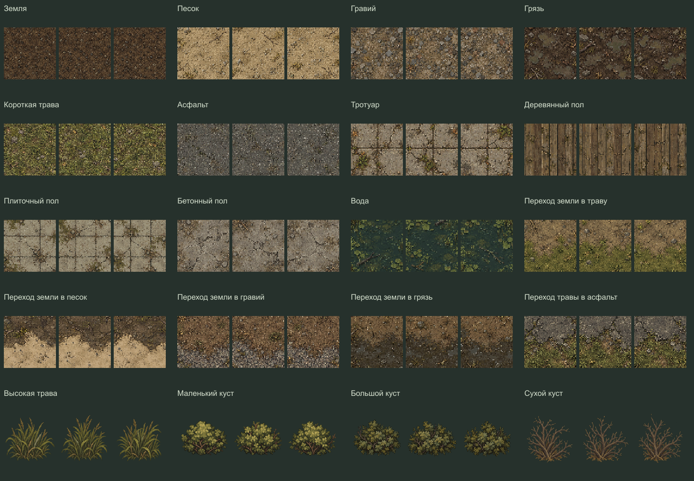

# Окружение и эффекты — три варианта каждого элемента

Готово 119 из 119 элементов, по три близких варианта A/B/C. Все три предназначены для совместного использования: это небольшие различия деталей, а не уровни силы или разные стили.

В экспорте: 258 статичных вариантов, 90 анимаций / 540 кадров, 9 референсов освещения.

## Просмотр

Откройте [preview.html](preview.html) двойным щелчком. Просмотрщик работает локально без сервера: поиск, категории, варианты A/B/C рядом, светлый фон и остановка анимаций. На GitHub HTML показывается исходным кодом. Обзор всех элементов: [overview.png](overview.png).

## Файлы

- `sources/<element>.png` — неизменённые исходные листы встроенного image_gen, три варианта одного элемента на листе.
- `elements/<element>/*_a.png`, `*_b.png`, `*_c.png` — отдельные статичные варианты.
- У анимаций — шесть PNG-кадров на вариант, горизонтальный PNG-лист, JSON-атлас и GIF для просмотра.
- [manifest.json](manifest.json) — состав и параметры экспорта; [manifest.js](manifest.js) — те же данные для локального просмотрщика.
- [generation-plan.json](generation-plan.json) — полный перечень элементов и точные запросы генерации. Использован встроенный image_gen, без CLI/API-скриптов генерации.
- `records/*.json` — происхождение каждого исходника.
- `elements/<element>/export.json` — исходные области нарезки, результаты проверки альфа-канала и замечания.
- [lighting-presets.json](lighting-presets.json) — предлагаемые настройки оттенка и интенсивности освещения.
- [verification.json](verification.json) — последний отчёт проверки файлов.

## Экспорт

Покрытия: 64×64 пикселя, вид сверху. Предметы: прозрачные квадратные холсты 128/192/256 пикселей. Эффекты: 192×192, шесть кадров. Экспорт использует ближайшего соседа, сохраняет исходную прозрачность и один общий масштаб/область обрезки для всех вариантов и кадров элемента. Отдельные кадры не центрируются по отдельности.

Координаты: +X вправо, +Y вниз. У статичных предметов предложена нижняя центральная точка привязки, у покрытий и эффектов — центральная. Точные игровые размеры и коллизии выбираются при интеграции: большой холст не означает большой объект в мире. GIF служат просмотру: у одноразовых действий в конце есть пауза; игровые параметры находятся в manifest.

## Границы готовности

Это сгенерированная графика и её экспорт. Проверка файлов подтверждает состав, уникальность, размеры, альфа-канал и атласы. Она не подтверждает бесшовность покрытий, геометрию соединений дорог или качество движения в движке. Эти свойства требуют проверки на собранной карте. Три панели дня/сумерек/ночи являются визуальными референсами; игровое освещение, погода, столкновения, открытие дверей и боевые события ещё не реализованы.

## Воспроизведение экспорта

`node tools/build-environment-variants.cjs`

`node tools/check-environment-variants.cjs`

`node tools/build-environment-variants.cjs --zip` — архив `output/environment-variants-v1.zip`. Исходную графику эти команды не генерируют.
