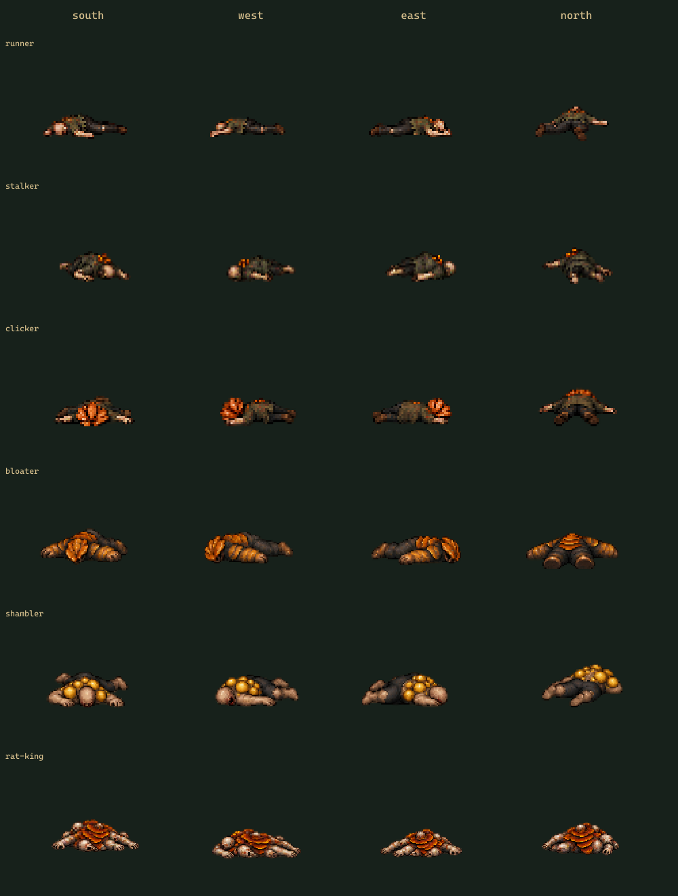

# Смерть и лежащие тела — v1

Шесть типов заражённых: runner, stalker, clicker, bloater, shambler, rat-king. Для каждого четыре направления: south (спереди), west (левый бок), east (правый бок), north (со спины).

**24 однократные анимации смерти × 6 кадров = 144 новых кадра. Дополнительно 24 статичных PNG тела.** Тела совпадают с последним кадром смерти; они не считаются отдельными анимациями.

Откройте [preview.html](preview.html) для просмотра. Смерть останавливается на теле; кнопка «Повторить» запускает её заново. Ниже одновременно показаны неподвижные тела. GIF в `previews` и `comparisons` повторяются с паузой 2,2 секунды на теле для сравнения; игровые настройки остаются однократными.

## Файлы

В каждой папке `<тип>/<направление>/` находятся:

- `frames/death_<направление>_00.png` … `_05.png` — шесть прозрачных кадров.
- `corpse.png` — отдельное неподвижное тело, побайтово совпадает с кадром `_05`.
- `spritesheet.png` — шесть колонок, одна строка.
- `atlas.json` — Phaser JSON Hash, имена кадров без расширения.
- `animations.json` — скорость, `repeat: 0`, `terminalFrame`, `holdLastFrame`, точка привязки и описание тела.
- `previews/death.gif` — увеличенная демонстрация на тёмном фоне.
- `source-crops.json` — координаты извлечения и единый масштаб/сдвиг для всей последовательности.

Кадры: 64×64 у runner/stalker/clicker, 96×96 у bloater/shambler, 128×128 у rat-king. Точки привязки сохранены из v3: `(0.5, 0.875)`. Масштаб и смещение фиксированы для всей смерти, поэтому кадры падения не выравниваются заново по нижней границе тела. Направление — исходный ракурс персонажа при смерти.

Исходные шесть листов в `sources`: 1536×1024, шесть колонок кадров, четыре строки направлений south/west/east/north. `references` содержит использованные референсы утверждённого персонажа. Позы созданы встроенным image_gen; полные запросы в [generation-prompts.json](generation-prompts.json). Экспорт извлекает силуэты по альфа-каналу и масштабирует nearest-neighbor.

## Подключение

В [phaser-infected.js](phaser-infected.js) приведены загрузка, регистрация, `playInfectedDeath` и `showInfectedCorpse`. Первая функция запускает смерть один раз и оставляет тело после `animationcomplete`. Вторая восстанавливает тело из сохранённого состояния без повторного падения. Для полного набора используйте [v4](../infected-animation-pack-v4/README.md).

`rootMotion: false`: изображение падает внутри кадра; координаты объекта в мире не меняются. Игровая система должна отдельно выключить ИИ, атаки и коллизию живого врага, сохранить тип/ракурс/позицию тела и решить правила удаления/обыска. Эти игровые и сетевые механики пока не реализованы.

Проверки размеров, альфа-краёв, атласов, сохранения старых кадров и удержания тела в просмотрщике: [verification.json](verification.json). Архив: [infected-deaths-v1.zip](../../output/infected-deaths-v1.zip).
