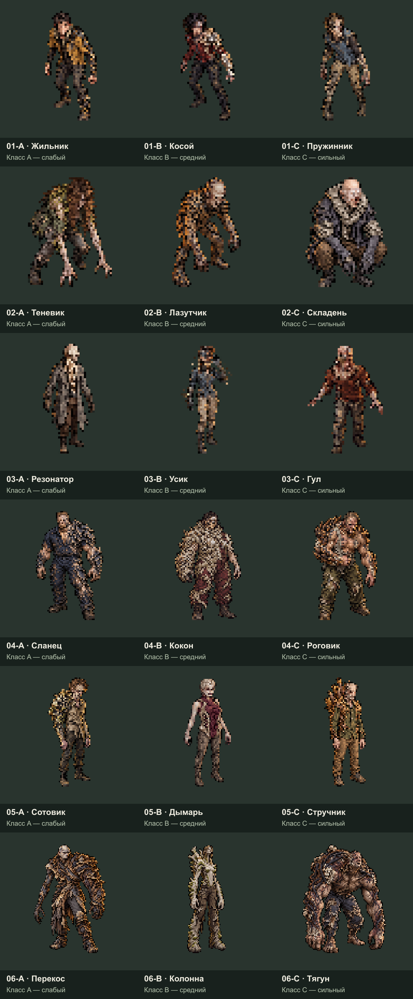

# Все 18 заражённых — статичные пиксельные образы

Пользователь утвердил все 18 реалистичных артов. Теперь каждый из шести видов включает три класса: **A — слабый, B — средний, C — сильный внутри своего вида**. Численные параметры пока не назначены. Это статичная графика; анимации и игровой код на этом этапе не создаются.

## Отдельные изображения

В таблице — увеличенные прозрачные PNG 512×512. Они предназначены для удобного просмотра пиксельного рисунка. Коды совпадают с реалистичными референсами.

| Вид | A — слабый | B — средний | C — сильный |
|---|---|---|---|
| Быстрый заражённый | [01-A Жильник](art/01-A.png) | [01-B Косой](art/01-B.png) | [01-C Пружинник](art/01-C.png) |
| Засадный заражённый | [02-A Теневик](art/02-A.png) | [02-B Лазутчик](art/02-B.png) | [02-C Складень](art/02-C.png) |
| Сенсорный заражённый | [03-A Резонатор](art/03-A.png) | [03-B Усик](art/03-B.png) | [03-C Гул](art/03-C.png) |
| Бронированный заражённый | [04-A Сланец](art/04-A.png) | [04-B Кокон](art/04-B.png) | [04-C Роговик](art/04-C.png) |
| Распространитель спор | [05-A Сотовик](art/05-A.png) | [05-B Дымарь](art/05-B.png) | [05-C Стручник](art/05-C.png) |
| Крупный босс | [06-A Перекос](art/06-A.png) | [06-B Колонна](art/06-B.png) | [06-C Тягун](art/06-C.png) |

## Состав

- [art](art): 18 отдельных увеличенных пиксельных PNG с прозрачным фоном.
- [sprites](sprites): те же 18 статичных спрайтов в небольшом размере: 64×64 для первых трёх видов, 96×96 для бронированных/распространителей, 128×128 для боссов.
- [sources](sources): все 18 исходных изображений генерации в полном разрешении.
- [comparisons](comparisons): шесть сравнений A/B/C с кодами, именами и силой класса.
- [manifest.json](manifest.json): связь референсов, имён, видов, классов и файлов. Общая точка привязки — `(0.5, 0.875)`.
- [verification.json](verification.json): проверка количества, уникальности, прозрачности и краёв экспортированных спрайтов.

Один ракурс, ориентированный вниз, со слегка приподнятой камерой. Это первый пиксельный прототип каждого образа; остальные направления и движения будут отдельными следующими задачами. Утверждённые реалистичные арты служат референсами. Отличия мутаций, одежды и силуэтов сохранены насколько позволяет небольшой пиксельный размер.

Графика создана встроенным image_gen, не простым уменьшением реалистичных фотографий. [Полные запросы](generation-prompts.json), [уточнения для двух вариантов](revision-prompts.json). Упаковочный инструмент лишь извлекает прозрачную фигуру, уменьшает готовое пиксельное изображение с nearest-neighbor, собирает подписи/сравнения и ZIP. Новых поз он не рисует.

[Полный ZIP](../../output/infected-redesign-pixel-v1.zip). [Утверждённые реалистичные арты](../infected-redesign-realistic-v1/README.md).
