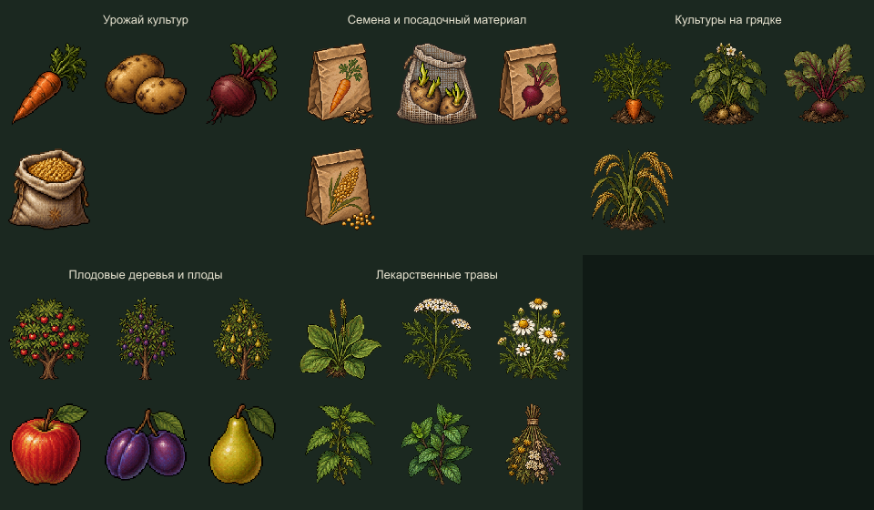
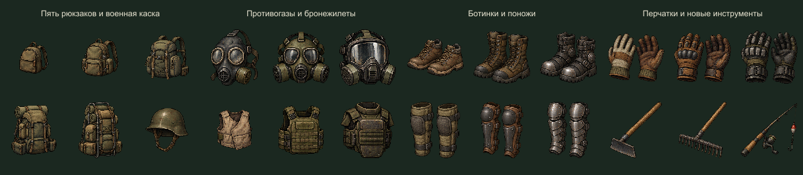
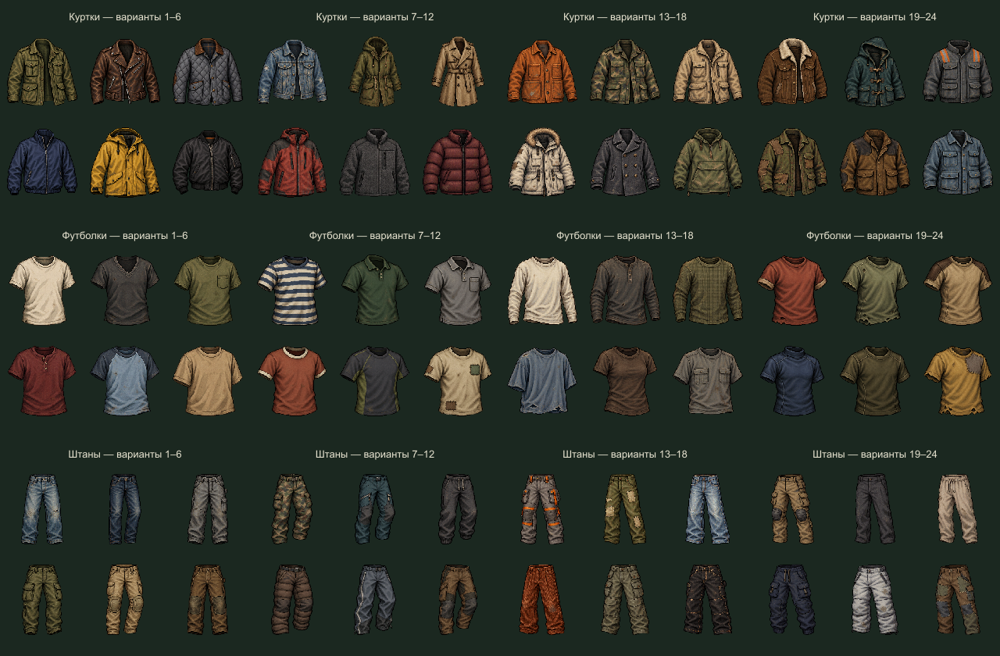
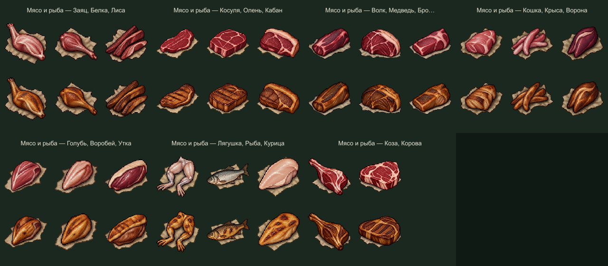
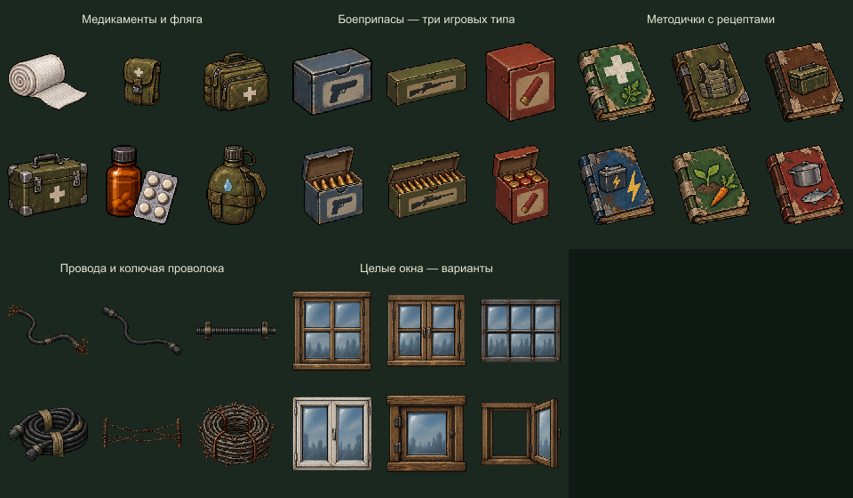

# Предметы v2 — земледелие, экипировка и выживание

**270 визуалов: 196 новых и 74 сохранённых.** Текущая версия набора предметов. Предыдущая коллекция заменена в публикации; её исходные версии доступны в истории Git.

[Локальный просмотрщик с поиском](preview.html) · [Манифест](manifest.json) · [Проверка](verification.json) · [Игровые договорённости](../../docs/items-design.md) · [Запросы imagegen](generation-prompts.json)

[Скачать полный ZIP в релизе GitHub](https://github.com/L1m1rd/pixel-apocalypse-game/releases/tag/item-visuals-v2).

## Что добавлено

| Раздел | Визуалы |
|---|---|
| Культуры | Морковь, картофель, свёкла, просо: урожай, посадочный материал и растения на грядках — 12 |
| Плодовые деревья | Яблоня, слива, груша и три вида плодов — 6 |
| Медицина и вода | Бинт, малая/средняя/большая аптечки, обезболивающее, фляга — 6 |
| Боеприпасы | Три условных игровых типа, закрытая/открытая коробка каждого — 6 |
| Экипировка и инструменты | Пять рюкзаков, военная каска, противогазы/бронежилеты/ботинки/поножи/перчатки трёх уровней, мотыга, грабли, удочка — 24 |
| Одежда | 24 варианта верхней одежды, 24 футболки/лонгслива, 24 пары штанов — 72 |
| Лекарственные травы | Подорожник, тысячелистник, ромашка, крапива, мята, сушёная смесь — 6 |
| Методички | Медицина, броня, патроны, электричество, земледелие, готовка — 6 |
| Проводка | Оголённый и изолированный провод на земле, защищённая линия, переносимый запас, установленная и переносимая колючая проволока — 6 |
| Целые окна | Шесть вариантов целого окна, включая открытое — 6 |
| Добыча ресурсов | Ягоды, грибы, ствол, пень, камень, доски — 6 |
| Мясо и рыба | 20 видов животных × сырое/жареное — 40 |

Материалы для крафта, свет/электричество, хранилища, прежние двери/окна, мебель, оборудование базы, отвлекающие предметы, основные природные объекты, транспорт и предметы доступа сохранены в составе 74 ранее одобренных визуалов.

## Земледелие и ресурсы

Просо — культура; пшено — название её урожая в игровом каталоге. Для картофеля изображён посадочный материал из проросших клубней. Семена остальных культур имеют собственные значки.

Сохранённые деревья, кусты и камни уже доступны в наборе. Новые пень и ствол показывают результат рубки; ягоды, грибы, камень и доски — отдельные изображения добычи. Сами действия сбора/рубки ещё не реализованы.

## Экипировка

Рюкзаки различаются размером, отделениями, поясом и каркасом. Уровни защиты различаются силуэтом и усилением деталей. Числа вместимости, прочности и защиты ещё не заданы. Это иконки отдельных предметов, а не уже надетая на персонажа одежда.

## 72 варианта одежды

Носки не добавлены. Существующие 24 модели огнестрела и их анимации остаются в своём наборе; новые огнестрельные модели и магазины здесь не создавались.

## Мясо и рыба

Состав взят из манифеста животных, подготовленного в чате «визуал природа»: заяц, белка, лиса, косуля, олень, кабан, волк, медведь, бродячая собака, кошка, крыса, ворона, голубь, воробей, утка, лягушка, рыба, курица, коза, корова. Вид `fish` в исходном наборе общий: дополнительные породы рыб не выдумывались.

На листе каждого вида сырой вариант расположен над жареным. Идентификаторы speciesId и foodState связывают пары в манифесте. Рецепты, пищевая ценность и механика готовки ещё не реализованы.

## Медицина, методички и проводка

В активной медицине ровно пять типов: бинт, три размера аптечек и обезболивающее. Малая аптечка должна лечить меньше средней, средняя — меньше большой. Обезболивающее немного восстанавливает ХП и временно снижает входящий урон. Числа и длительность ещё не заданы.

Коробки патронов разделены на пистолетный, винтовочный и дробовой типы. Это условная игровая совместимость, без утверждений о реальных калибрах конкретных моделей оружия.

Зелёный ящик из раздела электричества — **переносной аккумулятор**. Он сохранён с понятной подписью. Генератор, зарядное устройство, батарейки, лампа и фонарик также сохранены.

## Все листы

| Категория | Количество | Лист |
|---|---:|---|
| Урожай культур | 4 | [PNG](sheets/harvest.png) |
| Семена и посадочный материал | 4 | [PNG](sheets/seeds.png) |
| Культуры на грядке | 4 | [PNG](sheets/crop-plants.png) |
| Плодовые деревья и плоды | 6 | [PNG](sheets/orchard.png) |
| Медикаменты и фляга | 6 | [PNG](sheets/medicine-water.png) |
| Боеприпасы — три игровых типа | 6 | [PNG](sheets/ammunition.png) |
| Пять рюкзаков и военная каска | 6 | [PNG](sheets/backpacks-helmet.png) |
| Противогазы и бронежилеты | 6 | [PNG](sheets/masks-vests.png) |
| Ботинки и поножи | 6 | [PNG](sheets/boots-greaves.png) |
| Перчатки и новые инструменты | 6 | [PNG](sheets/gloves-tools.png) |
| Куртки — варианты 1–6 | 6 | [PNG](sheets/jackets-1.png) |
| Куртки — варианты 7–12 | 6 | [PNG](sheets/jackets-2.png) |
| Куртки — варианты 13–18 | 6 | [PNG](sheets/jackets-3.png) |
| Куртки — варианты 19–24 | 6 | [PNG](sheets/jackets-4.png) |
| Футболки — варианты 1–6 | 6 | [PNG](sheets/shirts-1.png) |
| Футболки — варианты 7–12 | 6 | [PNG](sheets/shirts-2.png) |
| Футболки — варианты 13–18 | 6 | [PNG](sheets/shirts-3.png) |
| Футболки — варианты 19–24 | 6 | [PNG](sheets/shirts-4.png) |
| Штаны — варианты 1–6 | 6 | [PNG](sheets/pants-1.png) |
| Штаны — варианты 7–12 | 6 | [PNG](sheets/pants-2.png) |
| Штаны — варианты 13–18 | 6 | [PNG](sheets/pants-3.png) |
| Штаны — варианты 19–24 | 6 | [PNG](sheets/pants-4.png) |
| Лекарственные травы | 6 | [PNG](sheets/herbs.png) |
| Методички с рецептами | 6 | [PNG](sheets/manuals.png) |
| Провода и колючая проволока | 6 | [PNG](sheets/wires.png) |
| Целые окна — варианты | 6 | [PNG](sheets/windows.png) |
| Собранные ресурсы и рубка дерева | 6 | [PNG](sheets/resource-harvest.png) |
| Мясо и рыба — Заяц, Белка, Лиса | 6 | [PNG](sheets/meat-1.png) |
| Мясо и рыба — Косуля, Олень, Кабан | 6 | [PNG](sheets/meat-2.png) |
| Мясо и рыба — Волк, Медведь, Бродячая собака | 6 | [PNG](sheets/meat-3.png) |
| Мясо и рыба — Кошка, Крыса, Ворона | 6 | [PNG](sheets/meat-4.png) |
| Мясо и рыба — Голубь, Воробей, Утка | 6 | [PNG](sheets/meat-5.png) |
| Мясо и рыба — Лягушка, Рыба, Курица | 6 | [PNG](sheets/meat-6.png) |
| Мясо и рыба — Коза, Корова | 4 | [PNG](sheets/meat-7.png) |
| Еда и напитки — сохранено | 3 | [PNG](sheets/retained-food.png) |
| Нож и топор — сохранённые — сохранено | 2 | [PNG](sheets/retained-weapons.png) |
| Инструменты — сохранено | 6 | [PNG](sheets/retained-tools.png) |
| Материалы для крафта — сохранено | 6 | [PNG](sheets/retained-materials.png) |
| Свет и электричество — сохранено | 6 | [PNG](sheets/retained-electricity.png) |
| Ёмкости и хранилища — сохранено | 6 | [PNG](sheets/retained-storage.png) |
| Двери и окна — сохранено | 6 | [PNG](sheets/retained-openings.png) |
| Мебель и укрытия — сохранено | 6 | [PNG](sheets/retained-furniture.png) |
| Оборудование базы — сохранено | 6 | [PNG](sheets/retained-base.png) |
| Предметы для отвлечения — сохранено | 6 | [PNG](sheets/retained-distraction.png) |
| Природные ресурсы — сохранено | 5 | [PNG](sheets/retained-nature.png) |
| Транспорт и детали — сохранено | 6 | [PNG](sheets/retained-transport.png) |
| Информация и доступ — сохранено | 6 | [PNG](sheets/retained-information.png) |
| Опасные объекты — сохранено | 4 | [PNG](sheets/retained-hazards.png) |

## Формат и готовность

- 34 новых исходных листа, 196 новых изображений и 74 сохранённых предмета.
- Для каждого предмета есть PNG 256×256 для просмотра и небольшой прозрачный спрайт. Размеры просмотра не являются окончательными размерами в игровом мире.
- Подписи добавлены только на сравнительных листах. Art и sprites имеют прозрачный фон.
- Изменённые визуалы созданы встроенным **image_gen**. [Полные запросы](generation-prompts.json); неизменённые исходные генерации находятся в sources. Сохранённые PNG находятся в retained.
- [game-rules.json](game-rules.json) фиксирует проект правил, связи культур, уровней и животных. Числа баланса оставлены пустыми.
- Роста растений, сбора урожая, крафта, лечения, брони, переноски, установки проводов и экипировки на героя в игре пока нет. Здесь подготовлены статичная графика и спецификация для будущей реализации.
- Методички — визуальные предметы с тематикой рецептов; сами рецепты, правила изучения и расходования книг ещё не выбраны.

Экспорт: `node tools/build-item-revision.cjs`. Проверка: `node tools/check-item-revision.cjs`. Проверка просмотрщика: `node tools/check-item-revision.cjs --viewer`. Упаковка: `node tools/package-item-revision.cjs`. Скрипты извлекают и упаковывают готовые изображения, не генерируют новые позы или предметы.
