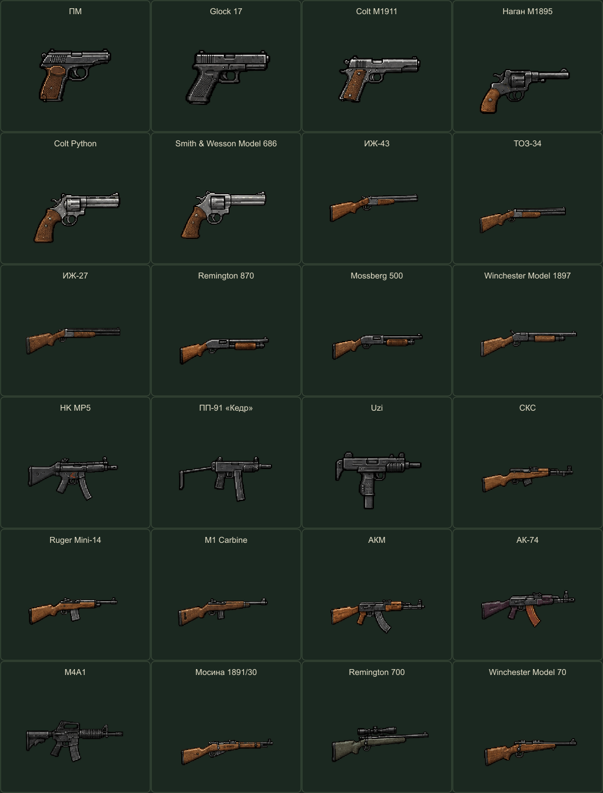

# Оружие — выстрел и перезарядка

**24 образца · 48 анимаций · 576 прозрачных кадров.** Для каждого оружия подготовлены 6 кадров выстрела и 18 кадров перезарядки, спрайт-лист, JSON-атлас, настройки и GIF.

[Открыть локальный просмотрщик](preview.html) · [Манифест](manifest.json) · [Отчёт проверки](verification.json) · [Запросы imagegen](generation-prompts.json) · [Уточнение Нагана](revision-prompts.json)

## Все выстрелы

## Все перезарядки

Сравнения синхронизированы по номеру позы. В отдельных GIF и просмотрщике используются длительности из настроек каждого оружия; GIF дополнительно повторяются с паузой. В игре обе анимации должны проигрываться однократно.

## Отдельные образцы

| Оружие | Выстрел | Перезарядка |
|---|---|---|
| ПМ | [GIF](pm/fire.gif) | [GIF](pm/reload.gif) |
| Glock 17 | [GIF](glock-17/fire.gif) | [GIF](glock-17/reload.gif) |
| Colt M1911 | [GIF](colt-m1911/fire.gif) | [GIF](colt-m1911/reload.gif) |
| Наган M1895 | [GIF](nagant-m1895/fire.gif) | [GIF](nagant-m1895/reload.gif) |
| Colt Python | [GIF](colt-python/fire.gif) | [GIF](colt-python/reload.gif) |
| Smith & Wesson Model 686 | [GIF](sw-686/fire.gif) | [GIF](sw-686/reload.gif) |
| ИЖ-43 | [GIF](izh-43/fire.gif) | [GIF](izh-43/reload.gif) |
| ТОЗ-34 | [GIF](toz-34/fire.gif) | [GIF](toz-34/reload.gif) |
| ИЖ-27 | [GIF](izh-27/fire.gif) | [GIF](izh-27/reload.gif) |
| Remington 870 | [GIF](remington-870/fire.gif) | [GIF](remington-870/reload.gif) |
| Mossberg 500 | [GIF](mossberg-500/fire.gif) | [GIF](mossberg-500/reload.gif) |
| Winchester Model 1897 | [GIF](winchester-1897/fire.gif) | [GIF](winchester-1897/reload.gif) |
| HK MP5 | [GIF](hk-mp5/fire.gif) | [GIF](hk-mp5/reload.gif) |
| ПП-91 «Кедр» | [GIF](pp91-kedr/fire.gif) | [GIF](pp91-kedr/reload.gif) |
| Uzi | [GIF](uzi/fire.gif) | [GIF](uzi/reload.gif) |
| СКС | [GIF](sks/fire.gif) | [GIF](sks/reload.gif) |
| Ruger Mini-14 | [GIF](ruger-mini14/fire.gif) | [GIF](ruger-mini14/reload.gif) |
| M1 Carbine | [GIF](m1-carbine/fire.gif) | [GIF](m1-carbine/reload.gif) |
| АКМ | [GIF](akm/fire.gif) | [GIF](akm/reload.gif) |
| АК-74 | [GIF](ak74/fire.gif) | [GIF](ak74/reload.gif) |
| M4A1 | [GIF](m4a1/fire.gif) | [GIF](m4a1/reload.gif) |
| Мосина 1891/30 | [GIF](mosin-9130/fire.gif) | [GIF](mosin-9130/reload.gif) |
| Remington 700 | [GIF](remington-700/fire.gif) | [GIF](remington-700/reload.gif) |
| Winchester Model 70 | [GIF](winchester-70/fire.gif) | [GIF](winchester-70/reload.gif) |

## Формат и границы готовности

- Один боковой ракурс вправо, **east**, отдельный слой оружия без рук и персонажа.
- Кадры 192×192 с прозрачностью; внутри папки каждого оружия находятся frames, idle.png, spritesheet.png, atlas.json и animations.json.
- Fire — 6 кадров, reload — 18. Настройки задают длительность каждого кадра; repeat=0 и rootMotion=false.
- Точка origin предварительная. Масштаб оружия относительно героя и крепление к рукам нужно откалибровать при интеграции. Другие ракурсы здесь не созданы.
- Вспышка встроена в кадры выстрела. При интеграции не нужно автоматически добавлять вторую такую же вспышку.
- События visual_muzzle_flash и visual_reload_complete — визуальные метки. Они не являются подтверждением попадания или расхода/выдачи патронов; это должна решать игровая логика.
- Длительности предложены для просмотра графики и не являются утверждённым балансом. Звука, урона, патронов, сетевой стрельбы и анимаций рук в наборе нет.
- Перезарядки стилизованы для читаемости в пиксельном масштабе. Это визуальные прототипы для игры.

Пистолеты и оружие со съёмным магазином показывают его смену. У Нагана отдельная перезарядка через боковое окно, у двух других револьверов — с откинутым барабаном. Двустволки раскрывают стволы, помповые дробовики показывают поштучную загрузку и цевьё, винтовки — затвор.

## Источники и воспроизведение

Графика и позы созданы встроенным **image_gen** по [утверждённому каталогу](../weapons-pixel-v1/overview.png). References содержит фрагменты каталога; sources — 24 исходных анимационных листа. Скрипты лишь извлекают позы, сохраняют общий масштаб и точку привязки, собирают атласы и GIF.

`node tools/build-weapon-animations.cjs` — экспорт всех готовых исходников.  
`node tools/check-weapon-animations.cjs` — проверка кадров, атласов и всех 48 действий в Edge.  
`node tools/package-weapon-animations.cjs` — общие GIF.  
`node tools/package-weapon-animations.cjs --zip` — локальный архив output/weapon-animations-v1.zip.

HTML-просмотрщик открывается локально после скачивания проекта. Он поддерживает выбор оружия, выстрел/перезарядку, паузу, покадровый просмотр, однократное проигрывание и повтор, светлый фон.
