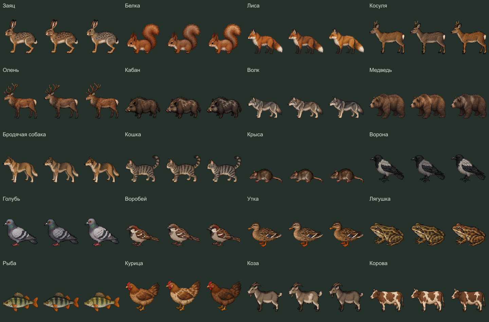

# Животные — статичные визуалы v1

Готово 20 из 20 видов, 60 обликов и 240 отдельных PNG: три близких варианта A/B/C, четыре направления (south, west, east, north). Для игры выбран вариант B у всех видов; A/C сохранены как предыдущие варианты.

[Просмотрщик](preview.html) открывается локально двойным щелчком без сервера. На GitHub HTML показывается исходным кодом. [Все ракурсы, лист 1](directions-01.png), [лист 2](directions-02.png), [лист 3](directions-03.png), [лист 4](directions-04.png).

## Состав

- Заяц — [12 ракурсов](sprites/hare/overview.png).
- Белка — [12 ракурсов](sprites/squirrel/overview.png).
- Лиса — [12 ракурсов](sprites/fox/overview.png).
- Косуля — [12 ракурсов](sprites/roe_deer/overview.png).
- Олень — [12 ракурсов](sprites/red_deer/overview.png).
- Кабан — [12 ракурсов](sprites/wild_boar/overview.png).
- Волк — [12 ракурсов](sprites/wolf/overview.png).
- Медведь — [12 ракурсов](sprites/brown_bear/overview.png).
- Бродячая собака — [12 ракурсов](sprites/stray_dog/overview.png).
- Кошка — [12 ракурсов](sprites/cat/overview.png).
- Крыса — [12 ракурсов](sprites/rat/overview.png).
- Ворона — [12 ракурсов](sprites/crow/overview.png).
- Голубь — [12 ракурсов](sprites/pigeon/overview.png).
- Воробей — [12 ракурсов](sprites/sparrow/overview.png).
- Утка — [12 ракурсов](sprites/duck/overview.png).
- Лягушка — [12 ракурсов](sprites/frog/overview.png).
- Рыба — [12 ракурсов](sprites/fish/overview.png).
- Курица — [12 ракурсов](sprites/chicken/overview.png).
- Коза — [12 ракурсов](sprites/goat/overview.png).
- Корова — [12 ракурсов](sprites/cow/overview.png).

## Файлы и происхождение

Графика создана встроенным image_gen. [Полные запросы](generation-plan.json), неизменённые исходные листы в sources, записи происхождения в records. Отдельные изображения и три горизонтальных спрайт-листа каждого животного с JSON-атласами находятся в sprites. [Манифест](manifest.json) содержит пути, размеры, контрольные суммы и предлагаемый игровой масштаб. [Проверка файлов](verification.json).

Нарезка сохраняет исходный альфа-канал. Один общий масштаб используется для всех 12 ракурсов вида; статичные позы расположены по нижнему центру. Увеличение/уменьшение выполняется ближайшим соседом. Виды на общем листе показаны для просмотра, а не в едином физическом масштабе.

## Готовность

Это статичные ракурсы спокойной позы, а не анимации ходьбы, бега, полёта, плавания или атак. Поведение животных и подключение к игре пока не реализованы. Окончательные размеры, ориентацию, мелкие детали на границах исходной сетки и точки привязки следует проверить в движке.

Экспорт: node tools/build-wildlife-visuals.cjs

Проверка: node tools/check-wildlife-visuals.cjs

Архив: node tools/build-wildlife-visuals.cjs --zip — output/wildlife-visuals-v1.zip. Эти команды экспортируют готовую графику, не генерируют новые изображения.
