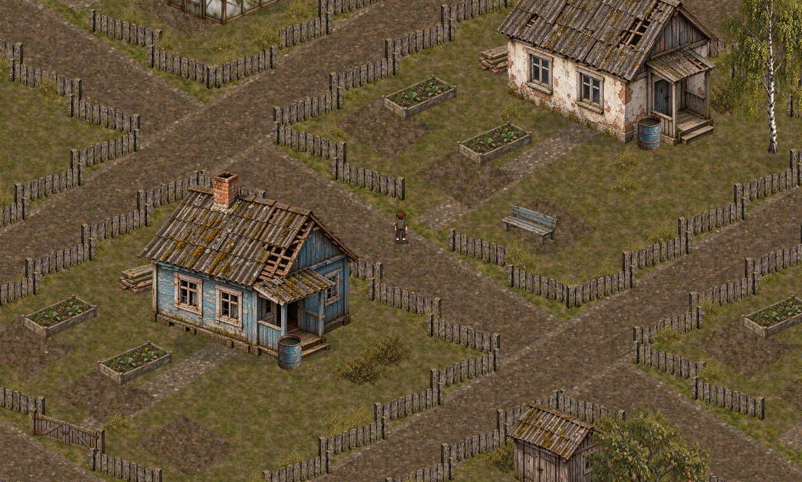
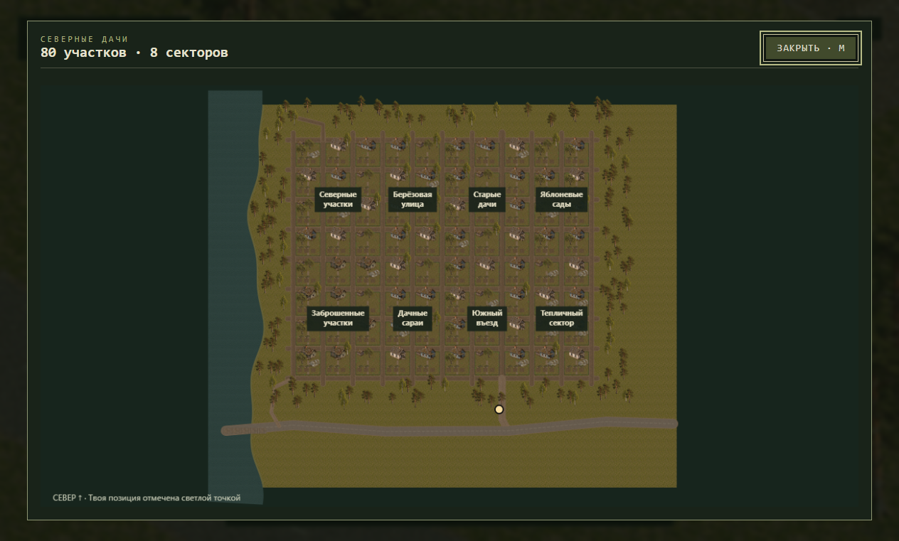

# Северные дачи — 0.3

Проходимый большой район: 80 участков, 60 дач и восемь подписанных секторов. Подключены подготовленные текстуры, теплицы, сараи, колодец, огороды, лесополоса, река и кольцевая дорога.

Распакуйте ZIP целиком и запустите PixelApocalypse.exe. Установка Node.js не требуется.

WASD / стрелки — движение; Shift — бег; C / Ctrl — присесть; E — ворота; M — карта; колесо — масштаб; H — скрыть интерфейс; Esc — пауза; F11 — полный экран.

Позиция героя и открытые ворота сохраняются автоматически. Для дач используется отдельный профиль сохранений. Дома пока без доступных интерьеров; бой и заражённые не подключены.

