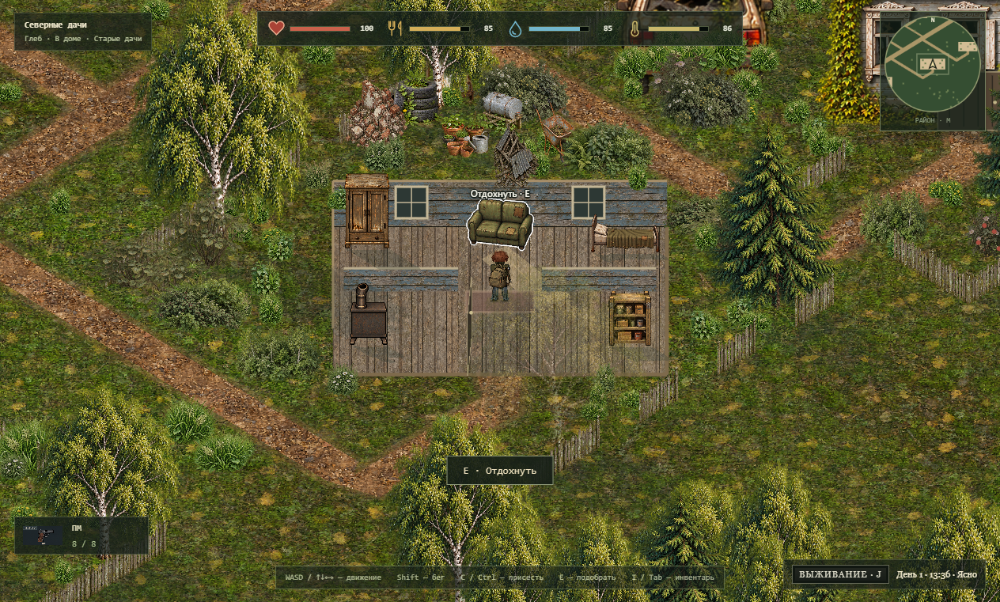
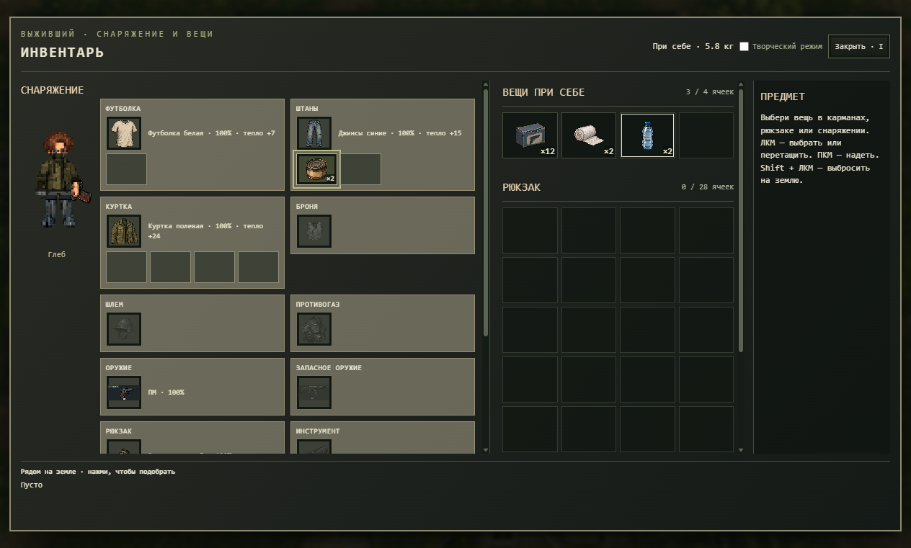

# Северные дачи 0.14 — дома, снаряжение и взаимодействия

Восемь кварталов и 80 домов остаются одной непрерывной игрой. Все фасады и входы домов теперь направлены к нижней стороне экрана. Шесть типов планировок отличаются размером, комнатами и обстановкой. Кровати и диваны восстанавливают силы; печь растапливается досками, позволяет согреться и приготовить сырую еду. Шкафы и кухонные хранилища содержат случайные припасы. Перегородки имеют коллизии; соседние заборы, машины и дворовые предметы исключены из внутренних помещений.

Главные улицы, проезды и тропы отличаются шириной. Уличное полотно плавно меняет ширину вдоль пути. В лесу появились отдельные рощицы с полянами, собираемые красные ягоды и камни. Ягоды съедобны, добыча камня оставлена для следующего этапа.

Верхняя полоса показывает здоровье, голод, жажду и температуру небольшими иконками. Заражённые и животные имеют тонкие полоски здоровья. Урон и восстановление здоровья показываются над героем числами; начало кровотечения — отдельной красной фразой. Рядом с доступным предметом появляются белая обводка и название. У дома выделяется дверь, у машины — задний багажник или грузовой борт. Двери и крышки открываются с анимацией. Обыск багажника начинается после открытия, его можно закрыть из панели обыска.

При входе крыша скрывается, камера плавно приближается на 28%; при выходе возвращается к выбранному колесом масштабу. Дом, за которым проходит герой, становится прозрачным, а герой выделяется белым контуром.

Снаряжение представлено карточками с иконкой, состоянием и теплом одежды. У футболки одна ячейка, у штанов две, у куртки четыре, у бронежилета две; объём рюкзака зависит от модели. Карманы принимают небольшие припасы, а типы слотов экипировки проверяются отдельно. Наполненная одежда сохраняет содержимое при снятии, замене, хранении в рюкзаке, выбрасывании и загрузке. Для новых персонажей оставлены четыре свободные ячейки при себе. Старые свободные стаки не теряются: лишние ячейки старого сохранения исчезают по мере освобождения.

ЛКМ — выбрать или перетащить; ПКМ — надеть/снять; Shift + ЛКМ — выбросить. E — дверь, багажник, обыск, сбор или подбор. I / Tab — снаряжение; R — перезарядка; Q — быстрый предмет; J — журнал и изготовление; M — карта. Творческий каталог остаётся отдельным режимом.

Старые сохранения переводятся на новые планировки с сохранением инвентаря, обыска, открытых дверей, построенных объектов и вещей внутри домов. Удалённые лесные россыпи заменены новым расположением рощ. Используются существующие канонические визуалы и их варианты; новых PNG и дубликатов игровых предметов не добавлено.

Проверки: `node --test desktop/*.test.mjs`, `node tools/check-asset-consistency.cjs`, `node tools/check-village-assets.cjs`, `node tools/check-village-directions.cjs`, `node tools/check-v014-runtime.cjs`. Для проверки готового EXE задайте `PIXEL_V014_EXE` и папку отчёта `PIXEL_V014_REVIEW`. Проверка создаёт отдельный профиль и не меняет пользовательский мир.

Результат выпуска: 93 теста логики пройдены, ошибок нет. Проверены все 80 входов и доступность мебели; в готовом Windows EXE пройдены 12 сценариев с шестью планировками, карманами, подбором, дверями, багажником, ягодами, полосками здоровья и сообщениями боя. Реальное сохранение 0.13 загружено дважды: положение внутри дома, выброшенная вещь, 12 старых свободных стаков, заряженные патроны и обыск сохранились. После финального исправления отдельно проверено закрывание багажника из-за заднего бампера и повторное использование белой маски героя. [Отчёт выпуска](verification/v014/release.json), [сценарии EXE](verification/v014/verification.json), [перенос сохранения](verification/v014/migration-verification.json).

